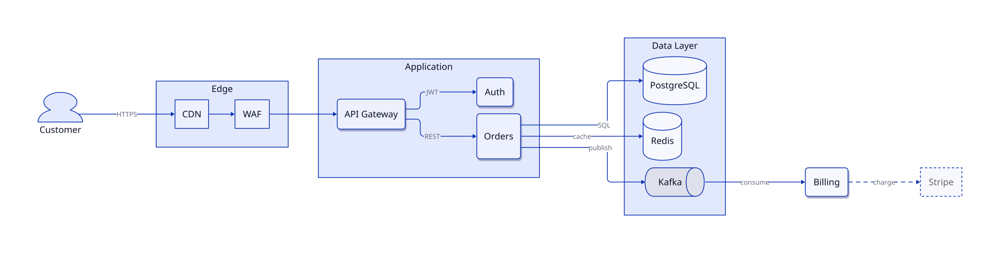
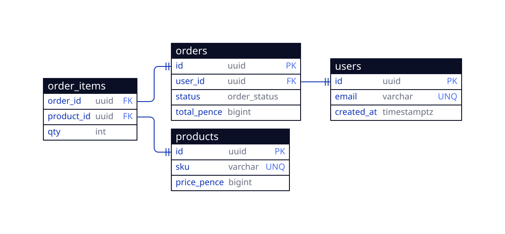
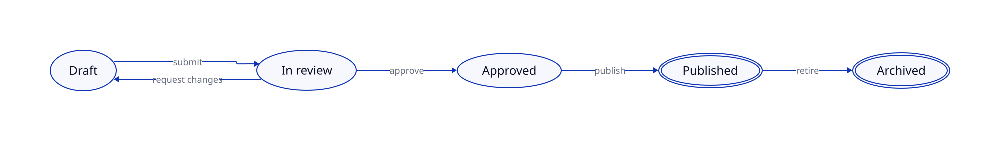
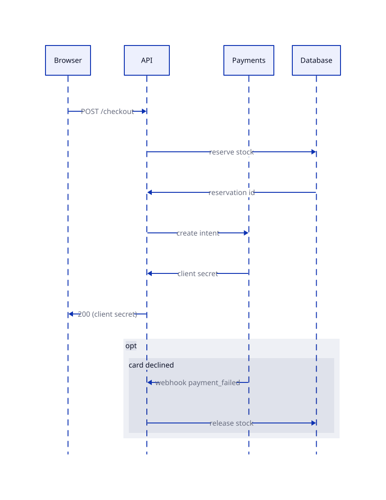
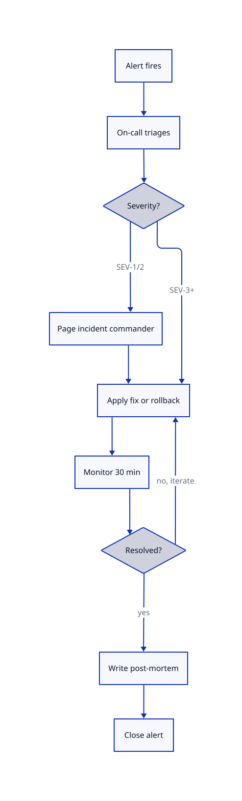

# D2 Diagrams for Claude Code

[](https://skills.sh/elliotnash/d2-diagram-skill)

**Ask for a diagram, get a professional SVG — checked by the agent's own eyes before you see it.**

A Claude Code plugin that gives Claude a complete [D2](https://d2lang.com) diagramming capability: it writes diagram-as-code, renders SVG with **TALA** — the architecture-focused layout engine now open source and bundled in d2 0.9.0 — falling back to **ELK** automatically, then **views its own render and fixes layout defects in a loop** before delivering. No more edge spaghetti shipped sight-unseen.



*All diagrams on this page were generated and self-checked by the plugin. They adapt to your colour scheme — try dark mode.*

## Why this exists

- **Diagram-as-code that's actually reviewed.** LLMs are good at writing D2 and bad at knowing how it will look. This plugin closes the loop: render → view → fix → repeat (typically 2–4 iterations) using a defect checklist for edge tangles, label drift, unbalanced composition, and truncated text.
- **TALA by default, ELK as a safety net.** TALA is Terrastruct's layout engine purpose-built for architecture diagrams; since d2 0.9.0 it is open source and ships inside d2 — no plugin, no licence key, no watermark. If a TALA render ever fails, the script re-renders with bundled ELK and says so.
- **SVG-first.** Crisp at every zoom, dark-mode capable (a single SVG responds to `prefers-color-scheme` when rendered with `--dark-theme`, as every diagram on this page was), embeddable in READMEs and docs sites.

## Install

**As a plugin (recommended — versioned updates):**

```
/plugin marketplace add elliotnash/d2-diagram-skill
/plugin install d2-diagrams@d2-diagram-skill
```

**As a bare skill (copy-paste):**

```bash
git clone https://github.com/elliotnash/d2-diagram-skill.git
cp -r d2-diagram-skill/skills/d2-diagrams ~/.claude/skills/
```

**Via [skills.sh](https://skills.sh/elliotnash/d2-diagram-skill) (works across 17+ agents):**

```bash
npx skills add elliotnash/d2-diagram-skill
```

**Requirements:** the [d2 CLI](https://d2lang.com/tour/install), **minimum 0.9.0** — the skill checks for it and guides the install (`brew install d2`, or `curl -fsSL https://d2lang.com/install.sh | sh -s --`). TALA, ELK and PNG export all ship inside d2 0.9.0, so nothing else is needed. On Windows the scripts run through Claude Code's Git Bash — no extra setup.

## Use it

Just ask:

> *"Diagram the architecture of this repo"*
> *"Draw the checkout flow as a sequence diagram"*
> *"Turn these CREATE TABLE statements into an ERD"*
> *"Visualise our incident process as a flowchart"*

Claude plans the diagram, writes the `.d2` source, renders it, inspects the result, fixes what looks wrong, and hands you both the SVG and the editable `.d2`.

## Examples

Sources for every example are in [`examples/`](examples/) — click any diagram to open it full size. The gallery SVGs were rendered with ELK (`--engine elk`); CI also renders every example with the default TALA engine.

**Entity-relationship diagram** (`sql_table`)

[](examples/erd-commerce.svg)

**State machine**

[](examples/state-machine.svg)

**Sequence diagram**

<p align="center"><a href="examples/sequence-checkout.svg"></a></p>

**Incident flowchart**

<p align="center"><a href="examples/flowchart-incident.svg"></a></p>

## Layout engines and licensing

| Component | Licence | Cost |
|---|---|---|
| This plugin | MIT | Free |
| D2 + TALA + ELK + dagre (d2 ≥ 0.9.0) | MPL-2.0 (open source) | Free |

As of d2 0.9.0, TALA is open source and bundled with d2, so this plugin uses it by default — locally and in CI, with no licence key and no watermark. Force another engine with `--engine elk|dagre`; ELK is often the better fit for long single-direction pipelines. Older d2 releases (which needed the separate, proprietary `d2plugin-tala`) are no longer supported.

## How the self-check loop works

1. **Validate + render** via `scripts/render.sh` — TALA by default with ELK fallback, d2 version floor, `file:line:col` compile errors fed back to the model.
2. **View** — the agent Reads the PNG preview of its own render.
3. **Audit** — two passes: does the diagram make its argument? then a defect checklist (label drift, edge tangles, crossing edges, cramped-vs-empty regions, truncated text).
4. **Fix at the source level** — direction, containers, shorter labels, `near`, TALA seed re-rolls, switching engine — never pixel-pushing.
5. **Repeat** until clean, then deliver SVG + source.

## Troubleshooting

| Problem | Fix |
|---|---|
| `d2: command not found` | `brew install d2` or `curl -fsSL https://d2lang.com/install.sh \| sh -s --` |
| `d2 X is too old — this skill requires d2 >= 0.9.0` | Upgrade d2: `brew upgrade d2` or re-run the install script |
| Report says `fallback: TALA render failed` | TALA errored on that source; the ELK render is fine to use. The report includes TALA's error |
| Icons missing in output | Some icons.terrastruct.com URLs 403 — remove or swap the icon |

## Credits

- [D2](https://github.com/terrastruct/d2) and its bundled TALA layout engine by Terrastruct.
- D2 rendering conventions informed by [claude-d2-diagrams](https://github.com/heathdutton/claude-d2-diagrams) by Heath Dutton (MIT).
- The render-and-self-check loop pattern — and the "a diagram should make an argument" planning discipline — were pioneered for Excalidraw by [Cole Medin](https://github.com/coleam00/excalidraw-diagram-skill); this plugin adapts both to D2, where native CLI rendering removes the browser/CDN dependency chain from diagram delivery and self-checks alike.

## Licence

MIT — see [LICENSE](LICENSE). d2 and its bundled TALA engine are MPL-2.0, from Terrastruct.
